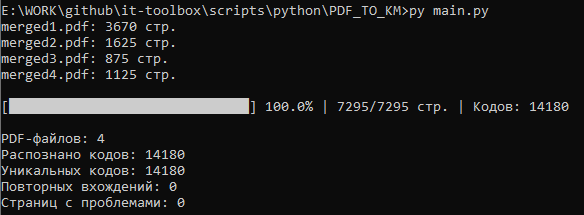

# Скрипт для распознавания PDF файлов честного знака в коды маркировки

## Причина написания скрипта

На сайте ГИС МТ, нет возможности скачать полноценные коды маркировки **с криптохвостом**. 
У вас есть возможность скачать по 500 кодов с PDF либо до 2000 eps печатью.
В данном скрипте происходит распознавания марок с PDF, для дальнейшей печати, подачи отчета о нанесении, ввода в оборот.

## Требования

Установите компоненты:
```
py -m pip install pymupdf numpy zxing-cpp openpyxl
```

## Использование
Поместите ваши PDF файлы с маркировками в каталог ```import```, запустите скрипт ```py main.py```

## Результат выполнения скрипта

```result\DataMatrix.csv``` - КМ с криптохвостом, для использования в отчете о нанесении

```result\DataMatrix.txt``` - КМ с криптохвостом, для использования в печатной программа (идентичен ```result\DataMatrix.csv```)

```result\KM.xlsx``` - КМ без криптохвоста, для ввода в оборот

```result\details.csv``` - подробности распознавания

```result\report.txt``` - итоги распознавания



